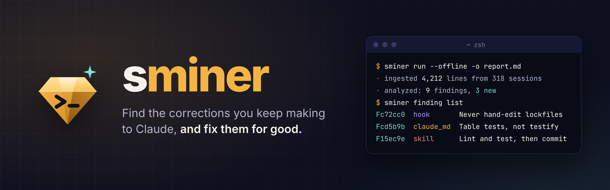
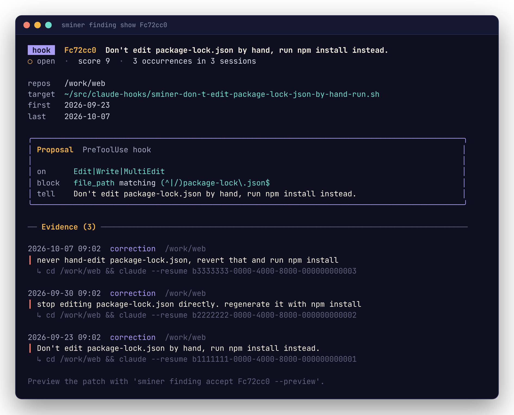
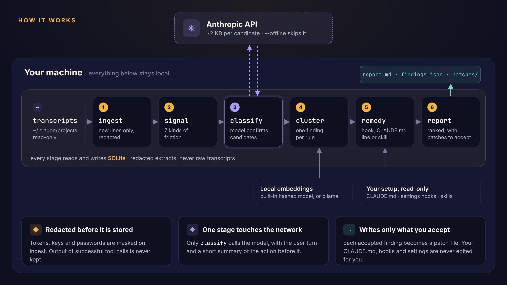

<p align="center">
  
</p>

<p align="center">
  <a href="https://github.com/rossedman/sminer/actions/workflows/ci.yml"></a>
  <a href="https://github.com/rossedman/sminer/actions/workflows/pages.yml"></a>
  <a href="LICENSE"></a>
  
</p>

sminer (session miner) reads your Claude Code session transcripts, finds the corrections and friction you repeat across sessions, and proposes a concrete fix for each: a hook, a CLAUDE.md line, or a skill. It turns your guardrails from hand-curated into evidence-driven.

It never edits CLAUDE.md, settings or hooks itself. Its output is a ranked report plus a ready-to-apply patch for each finding you accept.

**Docs: [rossedman.io/sminer](https://rossedman.io/sminer/)**

- **Evidence, not memory.** Seven detectors find corrections, interrupts, rewinds, repeated instructions, hook blocks, failure loops and manual fix-ups, then group them by the rule underneath and rank them by how often they happen and in how many repos.
- **The right remedy.** A rule a file path or command can enforce becomes a hook; judgment and style become a CLAUDE.md line; a procedure you keep re-explaining becomes a skill. Anything you already have is left out.
- **Private by default.** Secrets are redacted before anything is stored, transcripts are never copied, and `--offline` keeps everything local. Otherwise about 2 KB per candidate goes to the classifier.
- **Proof it worked.** `sminer finding trend` splits each finding's weekly rate at the day you adopted the fix.

<p align="center">
  
</p>

<p align="center">
  
</p>

## Install

```sh
go install github.com/rossedman/sminer/cmd/sminer@latest
```

It is a single binary with no cgo. The SQLite driver is pure Go (`modernc.org/sqlite`).

## Quick start

```sh
sminer run --offline                 # first pass, nothing leaves the machine; report on stdout
sminer run --output ~/notes/sminer.md

export ANTHROPIC_API_KEY=...
sminer run                           # the classifier confirms candidates and drafts proposals

sminer finding list                  # open findings, highest score first
sminer finding show F1a2b3c          # every excerpt behind one finding
sminer finding accept F1a2b3c --preview
sminer finding accept F1a2b3c        # prints the path of the patch it wrote
sminer finding dismiss F9d8e7f --reason "intentional in this repo"
sminer finding trend                 # weekly rate per finding, before vs after adoption
```

## Commands

```
Mining
  sminer run       [--since 90d] [--root DIR]... [--repo PATH] [--min-count 3] [-o FILE]
  sminer ingest    [--since 90d] [--root DIR]...
  sminer analyze   [--since 90d] [--repo PATH] [--min-count 3]
  sminer report    [--since 90d] [--repo PATH] [--min-count 3] [-o FILE]

Acting on findings
  sminer finding list     [--status open|accepted|dismissed|all]
  sminer finding show     <id>
  sminer finding accept   <id>... [--preview] [--patch-dir DIR]
  sminer finding dismiss  <id>... [--reason TEXT]
  sminer finding reopen   <id>...
  sminer finding trend    [<id>]

Other
  sminer config show | path
  sminer label [--limit N] [--export]
  sminer eval [--labels FILE] [--live]
  sminer version
  sminer completion bash|zsh|fish|powershell

Global flags
  --config FILE  --db FILE  --offline  --json  -q/--quiet  -v/--verbose  --no-color
```

`sminer <command> --help` shows examples for every command.

- **ingest** is incremental. Each transcript is re-read only from the byte offset where the last run stopped, and a partially written last line is left for the next run.
- **analyze** recomputes signals for sessions with new turns, confirms candidates with the classifier (unless offline), clusters the signals into findings, and routes each finding to a remedy.
- **report** prints Markdown on stdout, ranked by `count × weight × repos`. With `--output FILE` it writes the file atomically and puts `findings.json` beside it.
- **finding accept** renders the patch against the target as it is right now, writes it to the patch directory, prints its path, and records the adoption date so `finding trend` can show whether the fix worked. `--preview` prints the patch and changes nothing. CLAUDE.md lines accepted together for the same file share one patch.
- **label** walks you through real turns from your own transcripts and records which are corrections, so `eval` measures detection on your sessions.
- **finding reopen** undoes accept or dismiss.

### Output, scripting and exit codes

- stdout carries only data: reports, JSON, patch paths. Progress, warnings and errors go to stderr, so `sminer run > report.md` and pipes work as you'd expect. `-q` silences stderr except for errors; `-v` adds detail.
- `--json` works on every command that returns data, and errors are JSON too (on stderr): `{"error": {"code": "not_found", "exit": 4, "message": "...", "hint": "..."}}`. JSON fields are only ever added, never renamed or removed.
- On a terminal, output is drawn with [Charm](https://charm.sh)'s libraries: tables with score bars, finding cards, rendered reports, colored diffs, spinners, a full-screen labeller and styled help. Piped, every command prints a plain, line-oriented form instead: one record per line, no header. An empty result prints nothing and exits 0.
- Color only decorates text that already says the same thing. It is off when output isn't a terminal, with `NO_COLOR`, with `TERM=dumb`, and with `--no-color`. sminer assumes a dark background unless `COLORFGBG` says otherwise.
- Shell completion covers commands, flags and live finding IDs: `source <(sminer completion zsh)`.

| Exit code | Meaning |
|---|---|
| 0 | Success, including empty results |
| 1 | Runtime failure |
| 2 | Usage error: bad flag, argument or config value |
| 4 | The named finding does not exist |
| 5 | Precondition failed: nothing to patch, no remedy yet, target file already exists |
| 130 | Interrupted (Ctrl-C) |

### Renamed in 0.2

The 0.1 names still work until 2027-04-30, each printing a notice on stderr: `sminer show|accept|dismiss|trend` (now under `sminer finding`), `--no-llm` (now `--offline`), and `report --format`/`--out` (now `--json`/`--output`). `report` and `run` now print to stdout instead of writing `./sminer-report.md`; pass `--output` to write a file.

## What it looks for

| Signal | How it is detected | Weight |
|---|---|---|
| Correction | User turn after a tool action matching pushback cues ("no,", "don't", "instead", "I said", "revert", ...), then confirmed by the classifier | High |
| Interrupt | User interrupt marker, or a tool call rejected at the permission prompt (with the feedback typed there) | High |
| Rewind / branch | A `parentUuid` with more than one user-message child | Medium |
| Repeated instruction | Near-duplicate guidance-like prompts in 3 or more sessions | High |
| Hook block | Hook output in a tool result or system event showing a guardrail rejected an action | Medium |
| Tool failure loop | The same Bash command failing 2 or more times in a row | Medium |
| Manual fix-up | A later full `Read` of a file shows content Claude did not write (whitespace-only changes ignored), or Claude Code's "file was modified" notice | Low |

Heuristics run first and are cheap. Only candidate turns go to the classifier.

## Remedies

| Remedy | When | Patch |
|---|---|---|
| Hook | The rule is mechanically checkable (a file path or a command) | A `PreToolUse` script for `hooks_dir`, plus the `settings.json` entry to register it |
| CLAUDE.md line | Judgment or style the model must apply | A diff appending to the repo's `CLAUDE.md` (single-repo findings) or the global one |
| Skill | A multi-step procedure you keep re-explaining | A draft `SKILL.md` |
| Ignore | One-off (single session) or already covered by an existing CLAUDE.md line, hook or skill. A CLAUDE.md line you keep correcting Claude on after it was written is escalated to a hook instead, or listed as instructed but not followed | Listed in the report's appendix |

When both a hook and a CLAUDE.md line would fit, the hook wins: deterministic beats instructed. Hook-block findings become CLAUDE.md lines, because the guardrail already exists and Claude keeps tripping it.

## Configuration

sminer runs with no configuration. To change a setting, use a flag, an environment variable or the config file. The first one set wins, in this order:

1. command-line flags
2. `SMINER_*` environment variables: every key has one, e.g. `classifier.model` is `SMINER_CLASSIFIER_MODEL`, and `SMINER_OFFLINE=1` keeps everything local
3. the config file, `$XDG_CONFIG_HOME/sminer/config.yaml` (default `~/.config/sminer/config.yaml`), or the one named by `--config`
4. built-in defaults

`sminer config show` prints every effective value and the layer that set it. `sminer config path` prints the file location. See [`config.example.yaml`](config.example.yaml) for every key:

```yaml
roots: [~/.claude/projects]
window: 90d
min_count: 3
exclude_repos: ["~/personal/*"]
classifier:
  model: claude-haiku-5-5
  max_calls_per_run: 500
redact:
  patterns: ["(?i)aws_secret", "ghp_[A-Za-z0-9]+"]
remedies:
  hooks_dir: ~/src/claude-hooks
  global_claude_md: ~/.claude/CLAUDE.md
embeddings:
  provider: auto            # ollama if it answers locally, else the built-in hashed model
```

State lives under `$XDG_DATA_HOME/sminer` (default `~/.local/share/sminer`): the database `sminer.db` (mode `0600`), accepted patches in `patches/`, and your labels from `sminer label` in `labels.jsonl`. To uninstall completely, delete the binary, that directory and the config file.

## Privacy and safety

Transcripts contain work code, secrets pasted by accident, and internal hostnames.

- **Redaction on ingest.** Built-in patterns cover AWS keys, GitHub and GitLab tokens, JWTs, private keys, Anthropic/OpenAI-style keys, Slack tokens and `password=`-style assignments. Your configured patterns are added on top. Only redacted, truncated extracts are stored, and output from successful tool calls is not kept at all. Raw transcripts are never copied into the database; rows point back to a file path and byte offset.
- **Classifier calls** send only the candidate user turn and a truncated summary of the preceding assistant actions (tool name, path or command, a short snippet), capped at about 2 KB. They never include file contents or tool output bodies. When the model is enabled, `analyze` also sends up to 8 redacted excerpts per correction cluster in one call to draft a title and proposal. Hook, failure-loop and fix-up findings are never sent.
- **`--offline`** (or `SMINER_OFFLINE=1`) keeps everything on the machine. Repos matching `exclude_repos` are not ingested at all.
- **Embeddings are local.** They come from the built-in hashed model or a local ollama server.
- **Read-only against `~/.claude`.** `finding accept` writes only patch files, and only into the patch directory; `--output` writes only where you point it.
- Before you run the classifier on work repos, confirm that your employer's AI data policy allows it.

## How it works

A linear batch pipeline (diagram above) in which every stage reads from and writes to SQLite, so any stage can be re-run on its own. The [docs](https://rossedman.io/sminer/how-it-works/) walk through it stage by stage, with diagrams of [remedy routing](https://rossedman.io/sminer/findings/#remedy-routing) and [a finding's life](https://rossedman.io/sminer/findings/#a-findings-life).

Packages map one-to-one to stages: `transcript`, `ingest`, `signal`, `classify`, `cluster`, `remedy` and `report`, with `store` wrapping SQLite. Around them:

- `pipeline` runs the stages in order and defines the `--json` result types.
- `finding` handles the lifecycle after analysis: list, show, accept, dismiss, reopen and trend.
- `cli` is the cobra command tree. It parses input, resolves configuration through viper (`config`), and renders output, and it holds no domain logic.

Findings keep a stable ID across runs because each new cluster is matched to an existing finding (by centroid similarity for corrections, by exact key for hooks, failures and fix-ups). That way accept/dismiss state and trends survive re-analysis.

The transcript schema is undocumented and changes between releases. The decoder ignores unknown fields, accepts content as a string or as an array of blocks, and counts unknown event types (they appear in the report) instead of failing.

## Evaluation

```sh
make test       # unit, golden and end-to-end tests; classifier mocked
make eval       # heuristic precision/recall on testdata/labels
sminer eval --live   # also scores the live classifier (makes API calls)
```

- `testdata/projects` is a synthetic, redacted fixture corpus covering both transcript shapes (string content in 1.0.x, block content in 2.0.x). Regenerate it with `python3 testdata/gen_fixtures.py`.
- `testdata/labels/candidates.jsonl` holds hand-labelled candidate turns, and `pairs.jsonl` holds same-rule/different-rule pairs for tuning clustering. Both are starter sets. Grow them from your own transcripts; the spec targets about 200 candidates and at least 85% precision for corrections.

## Development

```sh
make check      # gofmt, go vet, tests
make fuzz       # fuzz the line decoder
```

The docs site is MkDocs Material, deployed to GitHub Pages by `.github/workflows/pages.yml`. Preview it with `pip install -r docs/requirements.txt && mkdocs serve`. The banner and diagrams are HTML in `docs/assets/src/`, rendered with `docs/assets/render.sh`.
