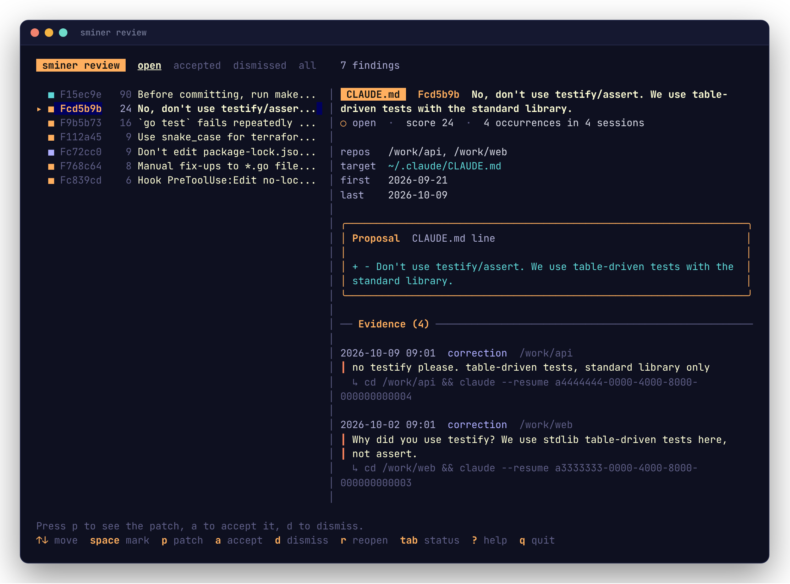
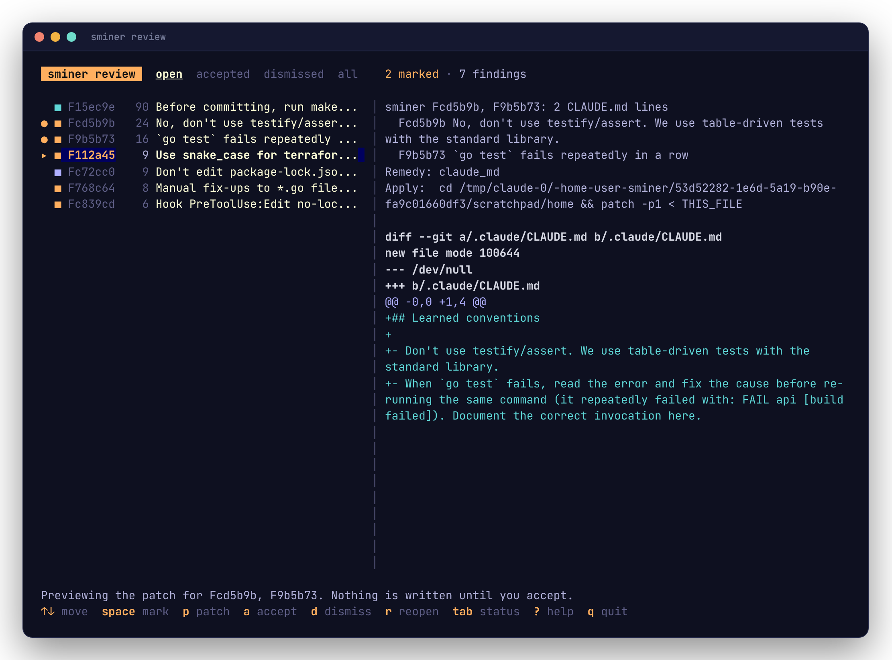
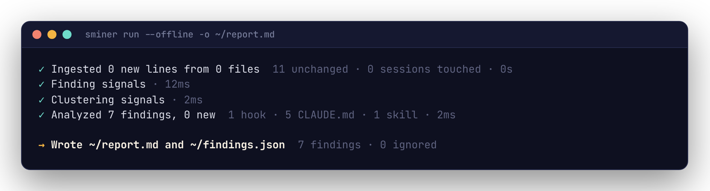
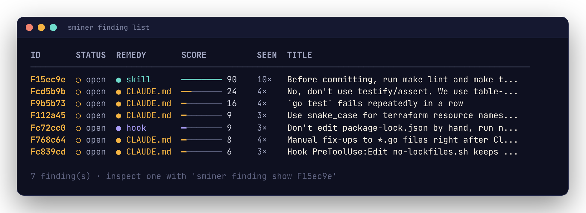
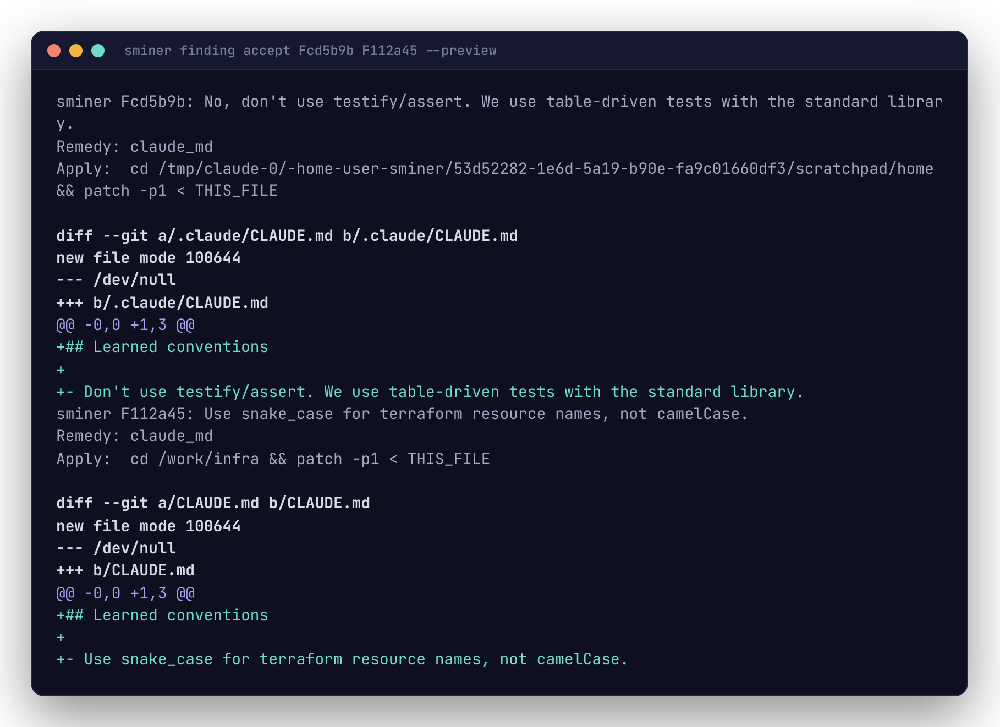
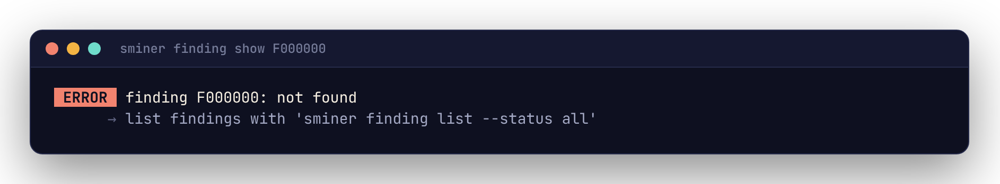

# CLI reference

sminer's commands read like sentences: `sminer <noun> <verb> <target> --modifier`. Every command has `--help` with examples. Bare `sminer` prints help.

This page is an overview. The [command reference](reference/commands/sminer.md) has every command's flags and examples, generated from the CLI itself.

```text
Mining
  sminer run        ingest, analyze and print the report
  sminer ingest     read new transcript lines into the database
  sminer analyze    find signals, cluster them, propose remedies
  sminer report     print the ranked report

Acting on findings
  sminer review     work through findings in a full-screen browser
  sminer finding list | show | accept | dismiss | reopen | trend

Other
  sminer config show | path
  sminer label
  sminer eval
  sminer version
  sminer completion bash | zsh | fish | powershell
```

## Global flags

| Flag | Meaning |
|---|---|
| `--config FILE` | Config file to read. Default: the first of `$XDG_CONFIG_HOME/sminer/config.yaml`, `~/.sminer.yaml` and `./.sminer.yaml` that exists. |
| `--db FILE` | Database file. Default: `$XDG_DATA_HOME/sminer/sminer.db`. |
| `--offline` | Never call the network. Same as `SMINER_OFFLINE=1`. |
| `--json` | Print machine-readable JSON on stdout. Same as `SMINER_JSON=1`. |
| `-q`, `--quiet` | Print nothing on stderr except errors. Same as `SMINER_QUIET=1`. |
| `-v`, `--verbose` | Print detail on stderr. Same as `SMINER_VERBOSE=1`. |
| `--no-color` | Disable color. Same as `NO_COLOR=1` or `SMINER_NO_COLOR=1`. |

## Mining

### `sminer run`

Ingest, analyze and report in one go. The report goes to stdout as Markdown, or JSON with `--json`. With `--output FILE`, it's written to that file and `findings.json` is written beside it.

```bash
sminer run --offline
sminer run --output ~/notes/sminer.md
sminer run --json | jq '.findings[].title'
```

| Flag | Default | Meaning |
|---|---|---|
| `--since` | `90d` | How far back to look: `90d`, `2w`, `12h` |
| `--root DIR` | `~/.claude/projects` | Transcript directory; repeatable |
| `--repo PATH` | | Only consider sessions in this repository |
| `--min-count N` | `3` | Occurrences a finding needs to be reported |
| `-o`, `--output FILE` | stdout | Write the report to a file |

### `sminer ingest`

Read new transcript lines into the database. Incremental: each file is re-read only from where the last run stopped.

| Flag | Default | Meaning |
|---|---|---|
| `--since` | `90d` | Only read transcripts modified within this window |
| `--root DIR` | `~/.claude/projects` | Transcript directory; repeatable |

### `sminer analyze`

Find signals in sessions with new turns, confirm candidates with the classifier (unless offline), cluster them into findings and route each to a remedy. Takes `--since`, `--repo` and `--min-count`, like `run`.

### `sminer report`

Print the ranked report. Takes `--since`, `--repo`, `--min-count` and `--output`, like `run`.

## Acting on findings

### `sminer review`

Work through findings in a full-screen browser: the list on the left, the selected finding (or its patch) on the right, one key per action.



| Key | Action |
|---|---|
| `↑` `↓` / `j` `k` | Move through findings; `g` `G` jump to the first and last |
| `space` / `x` | Mark a finding. Actions apply to every marked one, or to the one under the cursor when none are marked |
| `p` / `enter` | Show the patch accepting would write. Nothing is written |
| `a` | Accept: write the patch and record the adoption, like `finding accept` |
| `d` | Dismiss, with an optional reason |
| `r` | Reopen an accepted or dismissed finding |
| `tab` / `shift+tab` | Switch between open, accepted, dismissed and all |
| `J` `K` / `pgup` `pgdn` | Scroll the right pane |
| `?` | Every key |
| `q` / `esc` | Quit |



CLAUDE.md lines marked together for the same file share one patch, as with `finding accept F1 F2`. Accepted and dismissed findings stay in the list with their new status until you switch tabs.

When you quit, the paths of the patches written go to stdout, one per line, and a summary with each patch's apply command goes to stderr. `--json` prints `{"patches": [...], "accepted": n, "dismissed": n, "reopened": n}` instead.

| Flag | Meaning |
|---|---|
| `--status S` | Tab to start on: `open` (default), `accepted`, `dismissed` or `all` |
| `--patch-dir DIR` | Where to write patches (default `$XDG_DATA_HOME/sminer/patches`) |

`review` needs a terminal; without one it exits 2. Scripts use `finding list` and `finding accept`.

### `sminer finding list`

One finding per line, highest score first:

```text
ID       STATUS  REMEDY     OCCURRENCES  SESSIONS  SCORE  TITLE
Fc72cc0  open    hook       9            7         27     Never hand-edit package-lock.json
```

The header is printed only on a terminal. No findings prints nothing and exits 0. `--status` filters by `open` (the default), `accepted`, `dismissed` or `all`.

### `sminer finding show <id>`

The proposal, the target file and every excerpt behind the finding, each with the command that resumes its session.

### `sminer finding accept <id>...`

Render each finding's patch against its target as it is now, write it to the patch directory, print its path on stdout, and record the adoption date. The apply command, and the `settings.json` entry for a hook, go to stderr.

CLAUDE.md lines accepted together for the same file share one patch, named after their IDs (`F1a2b3c+F4d5e6f.patch`), and its path is printed once. Every patch is built before anything is written, so if one finding can't be patched, nothing changes.

| Flag | Meaning |
|---|---|
| `--preview` | Print the patch; write nothing and leave the finding unchanged |
| `--patch-dir DIR` | Where to write patches (default `$XDG_DATA_HOME/sminer/patches`) |

```bash
patch -d ~ -p1 < "$(sminer finding accept F1a2b3c)"
sminer finding accept F1a2b3c F4d5e6f F7a8b9c   # one patch per CLAUDE.md
```

### `sminer finding dismiss <id>...`

Hide findings that aren't worth fixing. `--reason` records why.

### `sminer finding reopen <id>...`

Undo accept or dismiss. For an accepted finding this also forgets the adoption date. The patch file is left where it is.

### `sminer finding trend [<id>]`

Weekly occurrence rates. Without an id: one line per finding, with before and after rates and a sparkline of recent weeks. With an id: week-by-week counts and the before/after comparison.

## Other

### `sminer config show`

Every setting, its effective value, and the layer that set it: `flag --…`, `env SMINER_…`, `file …` or `default`. See [Configuration](configuration.md).

### `sminer config path`

The config file's path, whether or not it exists. `--json` adds `exists` and the data directory.

```bash
$EDITOR "$(sminer config path)"
```

### `sminer label`

Label real candidate turns from your own transcripts, one at a time, in a full-screen labeller: `y` correction, `n` not, `s` skip, `q` quit. A single key answers; no Enter needed. Each answer is appended to the labels file as you give it. The file's path goes to stdout at the end. See [Evaluation](evaluation.md#label-your-own-turns).

| Flag | Meaning |
|---|---|
| `--out FILE` | Labels file to append to (default `$XDG_DATA_HOME/sminer/labels.jsonl`) |
| `--limit N` | Turns to label this session (default 50) |
| `--seed N` | Sampling seed, for a repeatable sample |
| `--export` | Write the sample to stdout as JSONL with `"correction": null`, to label in an editor |

Labelling needs a terminal; without one it exits 2 and suggests `--export`.

### `sminer eval`

Score correction detection against a labelled set: by default the one `sminer label` writes, or any file passed with `--labels`. `--live` also scores the classifier. See [Evaluation](evaluation.md).

### `sminer version`

The version, commit, Go version and platform. `--json` adds the full command tree, for tools that introspect.

## Output

sminer treats its output as an interface.

- **stdout is data:** the report, JSON, patch paths, lists. **stderr is everything else:** progress, warnings, hints and errors. `sminer run > report.md` captures only the report.
- **`--json` works on every command that returns data.** Fields are only ever added, never renamed or removed.
- **Piped lists are line-oriented:** one record per line, stable field order, no header. On a terminal they are drawn as tables (below).
- **Empty is not an error.** No findings exits 0, prints nothing in plain mode, and prints `[]` with `--json`.
- **Color only decorates.** It's off when the output isn't a terminal, with `NO_COLOR`, with `TERM=dumb`, and with `--no-color`.

### On a terminal

When a person is reading, sminer draws its output with [Charm](https://charm.sh)'s libraries: lists become tables with score bars, `finding show` becomes a card, `report` becomes a one-screen overview (evidence stays in `finding show` and the Markdown form), diffs are colored, pipeline steps get a spinner, and help is styled. Piped or redirected, the same commands print the plain forms above, byte for byte, so scripts never see a box-drawing character.








Colors are downsampled to what your terminal supports. sminer assumes a dark background unless `COLORFGBG` says otherwise (`COLORFGBG=0;15` for dark text on light); help reads the background from the terminal itself.

Errors on a terminal get a badge; elsewhere they stay as `error:` and `hint:` lines that logs and scripts can match.



## Errors and exit codes

An error is one line saying what failed, then a hint with the command that fixes it:

```text
error: finding F000000: not found
hint: list findings with 'sminer finding list --status all'
```

With `--json`, the error is a JSON object on stderr:

```json
{"error": {"code": "not_found", "exit": 4, "message": "finding F000000: not found", "hint": "list findings with 'sminer finding list --status all'"}}
```

| Exit | Code | Meaning |
|---|---|---|
| 0 | | Success, including empty results |
| 1 | `failure` | Runtime error |
| 2 | `usage`, `config` | Bad flag, argument or config value |
| 4 | `not_found` | The named finding doesn't exist |
| 5 | `no_remedy`, `not_patchable`, `target_exists` | A precondition failed |
| 130 | `interrupted` | Ctrl-C |

A mistyped command gets a suggestion (`Did you mean analyze?`).

## Renamed commands

These 0.1 names still work until **2027-04-30**, each with a notice on stderr:

| Old | New |
|---|---|
| `sminer show`, `accept`, `dismiss`, `trend` | `sminer finding show`, `accept`, `dismiss`, `trend` |
| `--no-llm` | `--offline` |
| `report --format json` | `report --json` |
| `report --out FILE` | `report --output FILE` |
