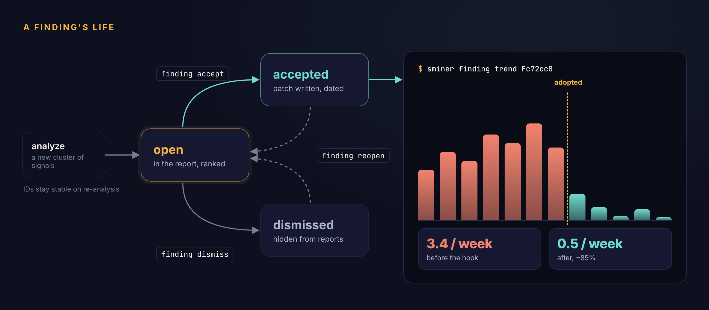

# Findings and remedies

A finding is one rule you keep correcting, backed by the signals that show it. This page covers how findings are formed and ranked, how each gets a remedy, and what happens when you accept one.

## How findings are formed

Signals that state the same rule are clustered into one finding. Corrections and repeated instructions cluster on meaning (the classifier's rule, or the excerpt when offline); hook blocks, failure loops and fix-ups group on an exact key. [How it works](how-it-works.md#cluster) has the details.

A finding needs at least `--min-count` occurrences (3 by default) to be reported. Its score is

```text
score = sum of signal weights × number of repos
```

so a correction you make in four repos outranks a more frequent one confined to a single repo.

Findings keep their ID from run to run. New evidence for a rule you've already seen attaches to the same finding, along with its status and history.

## Remedy routing

<figure class="diagram" markdown>
[](assets/routing.png)
</figure>

The rules, in order:

1. **Hook**, when a mechanical check can be extracted: a negated edit of a named file (*"don't edit package-lock.json"*, *"never touch go.sum"*) or a negated command (*"never run `git push --force`"*). When both a hook and a CLAUDE.md line would fit, the hook wins: a CLAUDE.md line is a request, a hook is a guarantee.
2. **Skill**, when the rule reads as a procedure (numbered or sequenced steps) or most of the evidence is repeated multi-step instructions.
3. **CLAUDE.md line** otherwise: judgment and style the model has to apply.

With the classifier on, the model also drafts a title and proposal for each correction cluster, choosing among the same remedies with the same preference for hooks. Its hook patterns are validated before they're used.

Some families have fixed remedies:

- **Hook blocks** become a CLAUDE.md line telling Claude the rule the hook enforces.
- **Failure loops** become a CLAUDE.md line asking Claude to read the error before re-running, with a prompt to document the right invocation.
- **Fix-ups** become a CLAUDE.md line asking Claude to match conventions and run the formatter for that kind of file.

### De-duplication

Before a proposal is reported, it's checked against what you already have. It's routed to **Ignore**, and listed in the report's appendix with the reason, when:

- every occurrence is in a single session (a one-off),
- an existing line in your global or repo CLAUDE.md says roughly the same thing,
- an existing hook (in `settings.json` or your hooks directory) already mentions the same file or command, or
- an installed skill has the same name or a similar description.

## The remedies

### Hook

A `PreToolUse` script for your hooks directory, plus the `settings.json` entry to register it. The script reads the tool call's JSON on stdin, pulls out the file path or command (with `jq`, or `python3` as a fallback), and exits 2 with a message when it matches. Claude Code then blocks the call and shows Claude the message.

```bash
if printf '%s' "$value" | grep -Eq -- '(^|/)package-lock\.json$'; then
  echo 'Blocked by sminer hook: Never hand-edit package-lock.json' >&2
  exit 2
fi
```

### CLAUDE.md line

A unified diff appending the rule under a `## Learned conventions` heading. The target is the repo's `CLAUDE.md` when every occurrence is in one repo, and your global `~/.claude/CLAUDE.md` when the rule spans repos.

```diff
 ## Learned conventions

+- Write table-driven tests with the standard library, not testify.
```

### Skill

A draft `SKILL.md` in your skills directory, with the steps taken from the instructions you kept typing. Treat it as a starting point and edit it before you rely on it.

## Accepting a finding

```bash
sminer finding accept Fc72cc0 --preview   # print the patch, change nothing
sminer finding accept Fc72cc0             # write it, print its path
```

`accept` renders the patch against the target **as it is right now**, writes it atomically to `$XDG_DATA_HOME/sminer/patches/<id>.patch`, and prints the path on stdout. The apply command and any follow-up step, such as the `settings.json` entry for a hook, go to stderr. Nothing else on your machine changes.

Every patch starts with a header naming the finding and the command to apply it:

```text
sminer Fc72cc0: Never hand-edit package-lock.json
Remedy: hook
Apply:  cd ~/src/claude-hooks && patch -p1 < THIS_FILE
```

`patch` and `git apply` both skip the header.

!!! warning "One patch per file at a time"
    Patches are rendered against the file as it is when you accept. Apply one before you accept another finding that targets the same CLAUDE.md, or the second patch won't apply cleanly.

## A finding's life

<figure class="diagram" markdown>
[](assets/lifecycle.png)
</figure>

| Status | Meaning | How to get there |
|---|---|---|
| `open` | In the report, ranked | New findings; `finding reopen` |
| `accepted` | Patch written; adoption date recorded | `finding accept` |
| `dismissed` | Hidden from reports and from `finding list` | `finding dismiss --reason …` |

Re-analysis never changes a finding's status. New evidence keeps attaching to it, which is what makes the trend meaningful.

## Trends

```bash
sminer finding trend           # every finding, one line each
sminer finding trend Fc72cc0   # week by week
```

For an accepted finding, the weekly rate is split at the adoption date:

```text
Before adoption: 3.40/week. After: 0.50/week over 4.0 weeks (-85%).
```

If the rate after adoption doesn't fall, the fix isn't working: a CLAUDE.md line Claude ignores is a good candidate for a hook.
